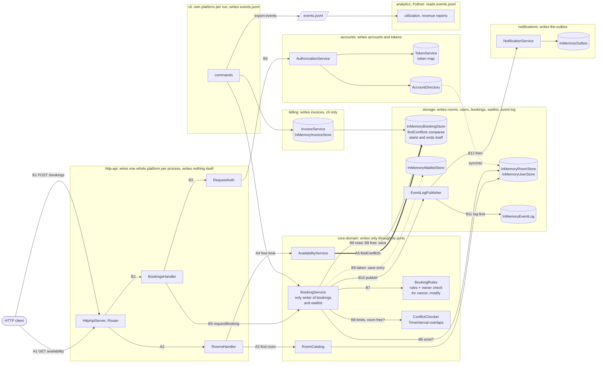

# BOUNDARIES.md

One section per milestone. Fill them in in order (the sketch before you write
anything about it, the copies next, the proposal last).

Draw Milestone 1's sketch from the code. A TA may ask where each arrow came
from.

Keep it short and specific. Point at modules, files, and callers.

---

## Milestone 1: The architecture as built

**The sketch.** Drawn from the wiring in
[`CampusReservePlatform`](http-api/src/main/java/edu/cmu/cs214/campusreserve/http/CampusReservePlatform.java),
the handlers, and the services they call. Each module's label says what it writes.
`A` arrows are an availability request, `B` arrows a booking request. Everything
inside `http-api` and below it is built once per server process.

- **Availability** (A, no credentials): A1 `GET /rooms/{roomId}/availability` →
  A2 `RoomsHandler.availability` → A3 `RoomCatalog.find` → A4 `AvailabilityService`
  (`freeOnDate`, `bookedMinutesOnDate`, `utilizationOnDate`, `openSlotsOnDate`) →
  A5 `BookingStore.findConflicts`, answered by `InMemoryBookingStore.findConflicts`.
  It never reaches `BookingService` or `ConflictChecker`.
- **Booking** (B): B1 `POST /bookings` with a bearer token → B2 `BookingsHandler.create`
  → B3 `RequestAuth.require` → B4 `AuthorizationService.authenticateHeader` (token map,
  account directory) → B5 `BookingService.requestBooking` → B6 room and user exist →
  B7 `BookingRules.checkRequest` → B8 own limits (`findActiveByUser`) and room free
  (`findActiveByRoom`), both through `ConflictChecker` → B9 free: `BookingStore.save`,
  201; taken: `WaitlistStore.save`, 202 → B10 publish `booking-created` (free only) →
  B11 `EventLogPublisher` appends the log first → B12 then notifications, into the outbox.

**Where your sketch and `ARCHITECTURE.md` disagree.**

1. **A second overlap check.** ARCHITECTURE.md draws `TimeInterval.overlaps` as
   "the only overlap implementation" (line 85). My sketch has a second one:
   `InMemoryBookingStore.findConflicts` compares starts and ends itself, and
   availability uses only that.
2. **The availability path.** ARCHITECTURE.md draws only the booking flow. My sketch
   has an availability path (A1 to A5) that goes from `RoomsHandler` through
   `AvailabilityService` straight to storage, with no `BookingService` and no
   `ConflictChecker`.
3. **The owner check.** ARCHITECTURE.md draws "(owner check via accounts)" between the
   handlers and `BookingService` (line 78). In my sketch `POST /bookings` only
   authenticates, and the owner check for cancel and modify is `BookingRules` in
   core-domain. The accounts owner check guards only reads.
4. **State outside `StoreRegistry`.** ARCHITECTURE.md says `StoreRegistry` builds the
   in-memory state and the event log can outlive a process (lines 193 to 196). My
   sketch has tokens, accounts, and the outbox outside `StoreRegistry`, and the
   server's event log is an `InMemoryEventLog` that dies with the process.

Where the two agree: the module graph. The imports in each module's `src/main` match
ARCHITECTURE.md's edge table exactly
(`grep -rhoE '^import edu\.cmu\.cs214\.campusreserve\.[a-z]+' <module>/src/main/java | sort -u`).

**How you decided which one is right.** All commands run from the repository root.

1. **Callers listed, and the tests read.**
   - `grep -rn 'isBefore' storage/src/main` finds
     [InMemoryBookingStore.java#L61-L62](storage/src/main/java/edu/cmu/cs214/campusreserve/storage/InMemoryBookingStore.java#L61-L62):
     `start.isBefore(windowEnd) && windowStart.isBefore(end)`, the same expression as
     [TimeInterval.java#L64](core-domain/src/main/java/edu/cmu/cs214/campusreserve/core/domain/TimeInterval.java#L64),
     written a second time. (Its other two hits, L88 and L96, compare one start with
     one instant, which is not an overlap.)
   - `grep -rn '\.overlaps(' --include='*.java' */src/main` finds only `ConflictChecker`
     (lines 34, 44, 62).
   - `grep -rn 'findConflicts(' --include='*.java' */src/main` finds only
     `AvailabilityService` (lines 35, 41).
   - core-domain's availability tests run against a fake store whose `findConflicts`
     calls `overlaps`
     ([InMemoryStores.java#L109-L111](core-domain/src/test/java/edu/cmu/cs214/campusreserve/core/support/InMemoryStores.java#L109-L111)),
     so they never run storage's comparison. Only storage's
     [FindConflictsTest](storage/src/test/java/edu/cmu/cs214/campusreserve/storage/FindConflictsTest.java)
     pins it. The two agree today, and nothing makes them keep agreeing.

   The code is what runs, so the document is wrong here, and the code breaks
   AGENTS.md rule 3.
2. **Wiring traced.**
   [CampusReservePlatform.java#L156](http-api/src/main/java/edu/cmu/cs214/campusreserve/http/CampusReservePlatform.java#L156)
   registers `RoomsHandler`.
   [RoomsHandler.java#L38](http-api/src/main/java/edu/cmu/cs214/campusreserve/http/RoomsHandler.java#L38)
   routes `/rooms/{roomId}/availability` to `availability()`, which calls
   `catalog.find` and four `AvailabilityService` methods. `AvailabilityService` is
   built from a `BookingStore` and a `BookingPolicy` only, and its one store call is
   `findConflicts` (the grep in 1). ARCHITECTURE.md lists this endpoint only in its
   HTTP table (line 173).
3. **Callers listed, and the test that pins it.**
   - `grep -rn 'auth\.require' http-api/src/main/java`: create
     ([BookingsHandler.java#L55](http-api/src/main/java/edu/cmu/cs214/campusreserve/http/BookingsHandler.java#L55)),
     modify (L109), and cancel (L134) call only `auth.require`. `requireActingFor`
     appears only at L83 (show), L95 (another user's list), and
     [WaitlistHandler.java#L51](http-api/src/main/java/edu/cmu/cs214/campusreserve/http/WaitlistHandler.java#L51).
   - For cancel and modify the owner check is
     [BookingRules.java#L126](core-domain/src/main/java/edu/cmu/cs214/campusreserve/core/policy/BookingRules.java#L126)
     (`booking.isOwnedBy(requesterId)`, `NOT_BOOKING_OWNER`, which
     [ErrorMapping.java#L24](http-api/src/main/java/edu/cmu/cs214/campusreserve/http/ErrorMapping.java#L24)
     turns into 403).
   - [ModifyBookingEndpointTest.anAdministratorIsNotAnOwner](http-api/src/test/java/edu/cmu/cs214/campusreserve/http/ModifyBookingEndpointTest.java#L102)
     expects 403 when an administrator changes Ada's booking. An accounts check
     would have let the administrator through (`mayActFor` is
     `canAdminister() || owns(...)`,
     [AuthorizationService.java#L88](accounts/src/main/java/edu/cmu/cs214/campusreserve/accounts/AuthorizationService.java#L88)),
     so the check that runs is core-domain's. The test passes in the baseline run.
4. **Wiring traced.** The
   [`CampusReservePlatform` constructor](http-api/src/main/java/edu/cmu/cs214/campusreserve/http/CampusReservePlatform.java#L42-L61)
   builds `StoreRegistry.inMemory()` (L44), then `new AccountDirectory()` (L52),
   `new TokenService(accounts, clock, TokenMinter.random())` (L53), and
   `new InMemoryOutbox()` (L56) beside it. That state lives in
   [TokenService.java#L31](accounts/src/main/java/edu/cmu/cs214/campusreserve/accounts/TokenService.java#L31)
   (the token map), `AccountDirectory.java` L24, `InMemoryOutbox.java` L23, and
   `InMemoryEventLog.java` L22.
   `grep -rn 'withEventLogFile\|new JsonlFileEventLogWriter' --include='*.java' */src/main`
   finds only `StoreRegistry`'s own factory (L37 to L38), so no entry point appends the log
   to a file. The server's log is a list in memory, and only the CLI's
   `export-events` writes one out.

---

## Milestone 2: Run it as copies

**Your stack.** The command that brought the stack up with two copies, and how
many distinct `X-Upstream` values your runs saw.

### Finding 1: tokens

**The claim.** One sentence, the one your script checks.

**The script and its result.** The file in `load/`, its threshold, and what a
run printed.

**Why, from the code.** The class that keeps tokens and how it is wired into
each copy. Say how you found it.

**The kind of problem.** Use the vocabulary from lecture.

### Finding 2: bookings

**The claim.**

**The script and its result.** Say how it reaches each copy directly, and why
it has to.

**Why, from the code.**

**The kind of problem.**

### What you checked

One thing your agent proposed that you checked (what it proposed, how you
checked it, and what came of it).

---

## Milestone 3: One boundary

Take one problem from Milestone 1 or 2 and propose the boundary that fixes it.

**The boundary.** The port, what it promises, and which side implements it. Say what
moves and what stays.

**Who owns the data.** Name the module that owns the data this boundary is about,
and say what everybody else is allowed to do with it.

**The one invariant that must not cross.** Exactly one, stated so that a reader
can tell whether a given piece of code violates it.

**What the boundary costs.** An interface to keep, a second implementation to
maintain, a performance argument to have again. Include what it leaves unfixed.

Feel free to read the appendix on what a good proposal looks like in the Lab 3 handout
before you write this section.
