# BOUNDARIES.md

One section per milestone. Fill them in in order (the sketch before you write
anything about it, the copies next, the proposal last).

Draw Milestone 1's sketch from the code. A TA may ask where each arrow came
from.

Keep it short and specific. Point at modules, files, and callers.

---

## Milestone 1: The architecture as built

**The sketch.** Drawn from the wiring in
[`CampusReservePlatform`](http-api/src/main/java/edu/cmu/cs214/campusreserve/http/CampusReservePlatform.java),
the handlers, and the services they call. Each module's label says what it writes.
`A` arrows are an availability request, `B` arrows a booking request. Everything
inside `http-api` and below it is built once per server process.

```mermaid
flowchart LR
  client(["HTTP client"])

  subgraph HTTP["http-api: wires one whole platform per process, writes nothing itself"]
    srv["HttpApiServer, Router"]
    rh["RoomsHandler"]
    bh["BookingsHandler"]
    ra["RequestAuth"]
  end

  subgraph ACC["accounts: writes accounts and tokens"]
    authz["AuthorizationService"]
    tok[("TokenService<br/>token map")]
    accDir[("AccountDirectory")]
  end

  subgraph CORE["core-domain: writes only through its ports"]
    cat["RoomCatalog"]
    av["AvailabilityService"]
    bs["BookingService<br/>only writer of bookings<br/>and waitlist"]
    rules["BookingRules<br/>rules + owner check<br/>for cancel, modify"]
    cc["ConflictChecker<br/>TimeInterval.overlaps"]
  end

  subgraph STO["storage: writes rooms, users, bookings, waitlist, event log"]
    ru[("InMemoryRoomStore<br/>InMemoryUserStore")]
    bookS[("InMemoryBookingStore<br/>findConflicts compares<br/>starts and ends itself")]
    waitS[("InMemoryWaitlistStore")]
    pub["EventLogPublisher"]
    evLog[("InMemoryEventLog")]
  end

  subgraph NOTIF["notifications: writes the outbox"]
    ns["NotificationService"]
    ob[("InMemoryOutbox")]
  end

  subgraph CLI["cli: own platform per run, writes events.jsonl"]
    cmds["commands"]
  end

  subgraph BIL["billing: writes invoices, cli only"]
    inv[("InvoiceService<br/>InMemoryInvoiceStore")]
  end

  subgraph ANA["analytics, Python: reads events.jsonl"]
    rep["utilization, revenue reports"]
  end

  jsonl[/"events.jsonl"/]

  client -->|"A1 GET availability"| srv
  client -->|"B1 POST /bookings"| srv
  srv -->|"A2"| rh
  srv -->|"B2"| bh
  rh -->|"A3 find room"| cat
  cat --> ru
  rh -->|"A4 free time"| av
  av ==>|"A5 findConflicts"| bookS
  bh -->|"B3"| ra
  ra -->|"B4"| authz
  authz --> tok
  authz --> accDir
  bh -->|"B5 requestBooking"| bs
  bs -->|"B6 exist?"| ru
  bs -->|"B7"| rules
  bs -->|"B8 limits, room free?"| cc
  bs -->|"B8 read, B9 free: save"| bookS
  bs -.->|"B9 taken: save entry"| waitS
  bs -->|"B10 publish"| pub
  pub -->|"B11 log first"| evLog
  pub -->|"B12 then"| ns
  ns --> ob
  accDir -.->|"syncInto"| ru
  cmds --> bs
  cmds --> inv
  inv --> bookS
  cmds -->|"export-events"| jsonl
  jsonl --> rep
```



- **Availability** (A, no credentials): A1 `GET /rooms/{roomId}/availability` →
  A2 `RoomsHandler.availability` → A3 `RoomCatalog.find` → A4 `AvailabilityService`
  (`freeOnDate`, `bookedMinutesOnDate`, `utilizationOnDate`, `openSlotsOnDate`) →
  A5 `BookingStore.findConflicts`, answered by `InMemoryBookingStore.findConflicts`.
  It never reaches `BookingService` or `ConflictChecker`.
- **Booking** (B): B1 `POST /bookings` with a bearer token → B2 `BookingsHandler.create`
  → B3 `RequestAuth.require` → B4 `AuthorizationService.authenticateHeader` (token map,
  account directory) → B5 `BookingService.requestBooking` → B6 room and user exist →
  B7 `BookingRules.checkRequest` → B8 own limits (`findActiveByUser`) and room free
  (`findActiveByRoom`), both through `ConflictChecker` → B9 free: `BookingStore.save`,
  201; taken: `WaitlistStore.save`, 202 → B10 publish `booking-created` (free only) →
  B11 `EventLogPublisher` appends the log first → B12 then notifications, into the outbox.

**Where your sketch and `ARCHITECTURE.md` disagree.**

1. **A second overlap check.** ARCHITECTURE.md draws `TimeInterval.overlaps` as
   "the only overlap implementation" (line 85). My sketch has a second one:
   `InMemoryBookingStore.findConflicts` compares starts and ends itself, and
   availability uses only that.
2. **The availability path.** ARCHITECTURE.md draws only the booking flow. My sketch
   has an availability path (A1 to A5) that goes from `RoomsHandler` through
   `AvailabilityService` straight to storage, with no `BookingService` and no
   `ConflictChecker`.
3. **The owner check.** ARCHITECTURE.md draws "(owner check via accounts)" between the
   handlers and `BookingService` (line 78). In my sketch `POST /bookings` only
   authenticates, and the owner check for cancel and modify is `BookingRules` in
   core-domain. The accounts owner check guards only reads.
4. **State outside `StoreRegistry`.** ARCHITECTURE.md says `StoreRegistry` builds the
   in-memory state and the event log can outlive a process (lines 193 to 196). My
   sketch has tokens, accounts, and the outbox outside `StoreRegistry`, and the
   server's event log is an `InMemoryEventLog` that dies with the process.

Where the two agree: the module graph. The imports in each module's `src/main` match
ARCHITECTURE.md's edge table exactly
(`grep -rhoE '^import edu\.cmu\.cs214\.campusreserve\.[a-z]+' <module>/src/main/java | sort -u`).

**How you decided which one is right.** All commands run from the repository root.

1. **Callers listed, and the tests read.**
   - `grep -rn 'isBefore' storage/src/main` finds
     [InMemoryBookingStore.java#L61-L62](storage/src/main/java/edu/cmu/cs214/campusreserve/storage/InMemoryBookingStore.java#L61-L62):
     `start.isBefore(windowEnd) && windowStart.isBefore(end)`, the same expression as
     [TimeInterval.java#L64](core-domain/src/main/java/edu/cmu/cs214/campusreserve/core/domain/TimeInterval.java#L64),
     written a second time. (Its other two hits, L88 and L96, compare one start with
     one instant, which is not an overlap.)
   - `grep -rn '\.overlaps(' --include='*.java' */src/main` finds only `ConflictChecker`
     (lines 34, 44, 62).
   - `grep -rn 'findConflicts(' --include='*.java' */src/main` finds only
     `AvailabilityService` (lines 35, 41).
   - core-domain's availability tests run against a fake store whose `findConflicts`
     calls `overlaps`
     ([InMemoryStores.java#L109-L111](core-domain/src/test/java/edu/cmu/cs214/campusreserve/core/support/InMemoryStores.java#L109-L111)),
     so they never run storage's comparison. Only storage's
     [FindConflictsTest](storage/src/test/java/edu/cmu/cs214/campusreserve/storage/FindConflictsTest.java)
     pins it. The two agree today, and nothing makes them keep agreeing.

   The code is what runs, so the document is wrong here, and the code breaks
   AGENTS.md rule 3.
2. **Wiring traced.**
   [CampusReservePlatform.java#L156](http-api/src/main/java/edu/cmu/cs214/campusreserve/http/CampusReservePlatform.java#L156)
   registers `RoomsHandler`.
   [RoomsHandler.java#L38](http-api/src/main/java/edu/cmu/cs214/campusreserve/http/RoomsHandler.java#L38)
   routes `/rooms/{roomId}/availability` to `availability()`, which calls
   `catalog.find` and four `AvailabilityService` methods. `AvailabilityService` is
   built from a `BookingStore` and a `BookingPolicy` only, and its one store call is
   `findConflicts` (the grep in 1). ARCHITECTURE.md lists this endpoint only in its
   HTTP table (line 173).
3. **Callers listed, and the test that pins it.**
   - `grep -rn 'auth\.require' http-api/src/main/java`: create
     ([BookingsHandler.java#L55](http-api/src/main/java/edu/cmu/cs214/campusreserve/http/BookingsHandler.java#L55)),
     modify (L109), and cancel (L134) call only `auth.require`. `requireActingFor`
     appears only at L83 (show), L95 (another user's list), and
     [WaitlistHandler.java#L51](http-api/src/main/java/edu/cmu/cs214/campusreserve/http/WaitlistHandler.java#L51).
   - For cancel and modify the owner check is
     [BookingRules.java#L126](core-domain/src/main/java/edu/cmu/cs214/campusreserve/core/policy/BookingRules.java#L126)
     (`booking.isOwnedBy(requesterId)`, `NOT_BOOKING_OWNER`, which
     [ErrorMapping.java#L24](http-api/src/main/java/edu/cmu/cs214/campusreserve/http/ErrorMapping.java#L24)
     turns into 403).
   - [ModifyBookingEndpointTest.anAdministratorIsNotAnOwner](http-api/src/test/java/edu/cmu/cs214/campusreserve/http/ModifyBookingEndpointTest.java#L102)
     expects 403 when an administrator changes Ada's booking. An accounts check
     would have let the administrator through (`mayActFor` is
     `canAdminister() || owns(...)`,
     [AuthorizationService.java#L88](accounts/src/main/java/edu/cmu/cs214/campusreserve/accounts/AuthorizationService.java#L88)),
     so the check that runs is core-domain's. The test passes in the baseline run.
4. **Wiring traced.** The
   [`CampusReservePlatform` constructor](http-api/src/main/java/edu/cmu/cs214/campusreserve/http/CampusReservePlatform.java#L42-L61)
   builds `StoreRegistry.inMemory()` (L44), then `new AccountDirectory()` (L52),
   `new TokenService(accounts, clock, TokenMinter.random())` (L53), and
   `new InMemoryOutbox()` (L56) beside it. That state lives in
   [TokenService.java#L31](accounts/src/main/java/edu/cmu/cs214/campusreserve/accounts/TokenService.java#L31)
   (the token map), `AccountDirectory.java` L24, `InMemoryOutbox.java` L23, and
   `InMemoryEventLog.java` L22.
   `grep -rn 'withEventLogFile\|new JsonlFileEventLogWriter' --include='*.java' */src/main`
   finds only `StoreRegistry`'s own factory (L37 to L38), so no entry point appends the log
   to a file. The server's log is a list in memory, and only the CLI's
   `export-events` writes one out.

---

## Milestone 2: Run it as copies

**Your stack.** [`compose.yaml`](compose.yaml) has `api`, `proxy`, and `k6` (in a
`load` profile, so `up` leaves it alone).

```
docker compose up -d --build --scale api=2
docker compose ps          # f26-lab09-api-1, f26-lab09-api-2, f26-lab09-proxy-1
docker compose logs api    # each copy prints its own u-1 and u-2 tokens
docker compose run --rm --no-deps -e ... k6 run /load/<script>.js
```

The two-copy runs saw **2** distinct `X-Upstream` values, `172.18.0.2:8080` and
`172.18.0.3:8080`. Those are the two copies' addresses (`docker inspect`). The
one-copy control run saw 1. Both scripts check the copy count themselves, with a
threshold, so a run that reached fewer copies than expected fails.

### Finding 1: tokens

**The claim.** A token works on any request, whichever copy answers it.

**The script and its result.** [`load/tokens.js`](load/tokens.js) sends
`GET /bookings` 40 times through `http://proxy` with copy 1's u-1 token. It has two
thresholds: `token_accepted: rate==1` (the claim) and
`distinct_upstreams: value>=EXPECT_COPIES` (default 2: did the run reach enough copies
to see the problem).

```
docker compose run --rm --no-deps -e TOKEN=<api-1's u-1 token> k6 run /load/tokens.js

40 requests through http://proxy, by the copy that answered:
  172.18.0.2:8080: 18 accepted
  172.18.0.3:8080: 0 accepted, 22 rejected (401 invalid_token)
distinct_upstreams  ✓ 'value>=2' value=2
token_accepted      ✗ 'rate==1'  rate=45.00%
```

- **Names the claim:** the claim is the script's first line, and `token_accepted` is
  the claim's metric.
- **Seen it fail:** above, with two copies.
- **Seen it pass:** with one copy (`--scale api=1`, `-e EXPECT_COPIES=1`), all 40 accepted,
  both thresholds ✓, exit 0.
- **Could it see the problem:** the same one-copy run without `EXPECT_COPIES=1` fails on
  `distinct_upstreams 'value>=2' value=1`, although every token was accepted. A run that
  never reached a second copy cannot pass as two-copy evidence.

**Why, from the code.** `TokenService` keeps tokens in a map in the process's memory,
`byValue`
([TokenService.java#L31](accounts/src/main/java/edu/cmu/cs214/campusreserve/accounts/TokenService.java#L31)).
- `CampusReservePlatform` builds its own `TokenService` with `TokenMinter.random()`
  ([CampusReservePlatform.java#L53](http-api/src/main/java/edu/cmu/cs214/campusreserve/http/CampusReservePlatform.java#L53)).
- `CampusReserveServer.main` builds one platform per process
  ([CampusReserveServer.java#L26](http-api/src/main/java/edu/cmu/cs214/campusreserve/http/CampusReserveServer.java#L26))
  and issues the two printed tokens on it (L35 to L36).
- So each copy mints its own random tokens and knows only those. On copy 2,
  `tokens.find` misses and `AuthorizationService` answers `INVALID_TOKEN`
  ([AuthorizationService.java#L43-L45](accounts/src/main/java/edu/cmu/cs214/campusreserve/accounts/AuthorizationService.java#L43-L45)),
  which `RequestAuth` turns into `401 invalid_token`.

How I found it: I followed the booking path from `RequestAuth.require` to the map
(Milestone 1, steps B3 and B4). Then
`grep -rn 'new TokenService' --include='*.java' */src/main` showed that only
`CampusReservePlatform` builds one.

**The kind of problem.** A *stateful service*. Session state (the token map) lives in
one replica's memory and is invisible to the other replica. The state has no shared
home, so "any replica can serve any request" is false. Sticky sessions would hide it,
not fix it: a copy that stops takes its sessions with it. The 478 green tests all run
in one process, so none of them could see this.

### Finding 2: bookings

**The claim.** A room slot is booked at most once.

**The script and its result.** [`load/bookings.js`](load/bookings.js) books three slots
in `r-1`: 09:00, 11:00 and 13:00 UTC, an hour each, seven days ahead. For each slot:

1. Copy A books it for u-1.
2. The script reads copy B's availability for that slot.
3. Copy B books the same slot for u-2.

Thresholds: `slot_double_booked: count==0` (the claim) and
`distinct_copies: value>=EXPECT_COPIES` (default 2). At the end it cancels everything
it made, so it can be run again.

How it reaches each copy directly: it uses `A_URL=http://f26-lab09-api-1:8080` and
`B_URL=http://f26-lab09-api-2:8080`. Those are the names `docker compose ps` gives,
and Docker's DNS resolves them for k6, which runs on the same network.

Why it has to:
- Through the proxy, a token only works on the copy that issued it (Finding 1), so
  about half the posts would stop at a 401 before reaching the room check.
- It uses two users so the room check is the only thing that can refuse B. With one
  store, a second booking by the *same* user is refused first by that user's own
  calendar (`checkAskerLimits`,
  [BookingService.java#L107](core-domain/src/main/java/edu/cmu/cs214/campusreserve/core/service/BookingService.java#L107),
  409 `USER_DOUBLE_BOOKED`), before the room is ever looked at.

Direct requests carry no `X-Upstream`, so the run shows two copies answered in three
other ways:
- the distinct addresses that answered (k6's `res.remote_ip`, the same address the
  proxy would have named);
- copy B's availability right after copy A confirmed;
- each copy's `/health` booking count before and after.

```
docker compose run --rm --no-deps \
  -e A_URL=http://f26-lab09-api-1:8080 -e A_TOKEN=<api-1's u-1 token> \
  -e B_URL=http://f26-lab09-api-2:8080 -e B_TOKEN=<api-2's u-2 token> \
  k6 run /load/bookings.js

r-1 2026-11-05T09:00:00Z: copy A 201 confirmed bk-e908b6a4; copy B then saw it FREE; copy B 201 confirmed bk-4c26c879
r-1 2026-11-05T11:00:00Z: copy A 201 confirmed bk-ce518eda; copy B then saw it FREE; copy B 201 confirmed bk-096060a4
r-1 2026-11-05T13:00:00Z: copy A 201 confirmed bk-673f228c; copy B then saw it FREE; copy B 201 confirmed bk-18b6a198
/health bookings, before -> after: copy A 0 -> 3; copy B 0 -> 3
answered from 2 address(es): 172.18.0.2:8080, 172.18.0.3:8080
distinct_copies     ✓ 'value>=2'  value=2
slot_double_booked  ✗ 'count==0'  count=3
```

- **Seen it fail:** above. A re-run on the same stack gave the same result, 3 of 3 slots
  held twice. The `/health` count includes cancelled bookings, which stay in the store as
  history, so it climbs from run to run.
- **Seen it pass:** both requests sent to copy 1 (with copy 1's u-1 and u-2 tokens, and
  `-e EXPECT_COPIES=1`). Every second request came back `202 waitlisted`, copy 1 showed the
  slot taken, `count=0`, exit 0.
- **Could it see the problem:** `distinct_copies` fails any run that did not reach two
  copies, in the same way as Finding 1.

**Why, from the code.** `requestBooking` checks and then inserts against the local
store. It reads `bookings.findActiveByRoom`, asks `ConflictChecker.hasConflict`, and then
calls `bookings.save`
([BookingService.java#L112-L124](core-domain/src/main/java/edu/cmu/cs214/campusreserve/core/service/BookingService.java#L112-L124)).
- `bookings` is the copy's own `InMemoryBookingStore`, a `ConcurrentHashMap` inside the
  process
  ([InMemoryRecordStore.java#L24](storage/src/main/java/edu/cmu/cs214/campusreserve/storage/InMemoryRecordStore.java#L24)).
- `StoreRegistry.inMemory()` builds it once per platform
  ([CampusReservePlatform.java#L44](http-api/src/main/java/edu/cmu/cs214/campusreserve/http/CampusReservePlatform.java#L44)),
  and there is one platform per process.
- So copy B checks copy B's store, which has never seen copy A's booking. It finds no
  conflict and saves. Availability reads the same local store, which is why copy B
  reported the slot free.
- The ids do not clash, because `createDefault()` uses UUIDs (L76). These are two
  separate bookings of one slot.

How I found it: I followed the booking path B5 to B9 from Milestone 1. Then
`grep -rn 'StoreRegistry.inMemory()' --include='*.java' */src/main` showed each entry
point builds its own set of stores (`CampusReservePlatform` and `CliContext`).

**The kind of problem.** A *global invariant* (no double booking) enforced by a *local*,
per-replica *check-then-insert*. This is the lecture's `threading.Lock` mistake: the
mechanism lives in one process, while the invariant spans every process.
- Each replica holds its own copy of the bookings, so there are two contradictory
  sources of truth. The same goes for the waitlist and its arrival numbers
  (`InMemoryWaitlistStore`'s own counter), and for the 5-booking cap per user, which
  becomes 10 across two copies.
- Copy B's "free" answer is the lecture's point that one copy cannot disagree with
  itself: two copies here do.
- It is worse than the lecture's race. With no shared store at all, the slot is booked
  twice even when the requests go one after the other, so no timing is needed.

### What you checked

**What the agent proposed.** Direct requests to a copy carry no `X-Upstream`. The
agent's first plan was to log which URL each request went to. Later it proposed reading
k6's `res.remote_ip` instead, as the stand-in for `X-Upstream`.

**How I checked it.**
- A URL only shows which name we asked for, not which process answered, so I compared
  the addresses the script printed with the containers' own addresses:
  `docker inspect -f '{{range .NetworkSettings.Networks}}{{.IPAddress}}{{end}}' f26-lab09-api-1 f26-lab09-api-2`
  gives `172.18.0.2` and `172.18.0.3`. Those match the script's addresses and the proxy's
  `X-Upstream` values in Finding 1.
- I ran the control run with both URLs pointing at copy 1. It printed one address, so
  the `distinct_copies` check can actually fail.

**What came of it.** The script counts `remote_ip` under a threshold, and logging URLs
was dropped.

---

## Milestone 3: One boundary

**The problem it fixes.** Finding 2, a *missing boundary*: nothing owns room time across
copies. So the "at most once" check sits in each copy's `BookingService`, which reads its
own process's store and then saves. That happens in
`requestBooking`
([BookingService.java#L112-L124](core-domain/src/main/java/edu/cmu/cs214/campusreserve/core/service/BookingService.java#L112-L124)),
in `modifyBooking` (L200, then L209), and in waitlist promotion (L288, then L306). At
two copies, `load/bookings.js` gets 3 of 3 slots confirmed twice.

**What it ends, and how to check it.** Copy B's request for a slot copy A holds reaches
`hold`, which answers `Taken`, so copy B waitlists the user (202) instead of confirming.
The check is the same script, unchanged: `load/bookings.js` fails at two copies today
and must pass at two copies afterwards.

**The boundary.** One owner of room time, behind the port core-domain already has.

- **The port.** `BookingStore` (core-domain, `core/ports/`) gains one method,
  `Hold hold(Booking booking)`. Its promise: *store this booking only if no other held
  booking for its room overlaps it, with the check and the write as one step for every
  process that shares the store.* It answers `Held`, or `Taken` with the conflicting
  bookings. A booking never collides with itself, so `hold` also serves a modify (same
  id, new interval).
- **Which side implements it.** `storage`, in a new adapter over one database that every
  copy connects to (a `db` service in `compose.yaml`).
  - The database enforces the rule through a table of 15-minute cells,
    `room_slots(room_id, slot_start, booking_id)`, with `UNIQUE(room_id, slot_start)`.
  - `hold` removes the booking's old cells and inserts its new ones in one transaction.
    A uniqueness violation rolls the transaction back and answers `Taken`.
  - `InMemoryBookingStore` implements `hold` too, with the check and the write under
    one lock. Tests and the CLI keep using it.
- **Why cells and not time ranges.** Every booking starts and ends on the 15-minute grid
  ([BookingRules.java#L72](core-domain/src/main/java/edu/cmu/cs214/campusreserve/core/policy/BookingRules.java#L72),
  [TimeInterval.java#L141](core-domain/src/main/java/edu/cmu/cs214/campusreserve/core/domain/TimeInterval.java#L141)).
  So two bookings overlap exactly when they share a cell, and half-open intervals come
  for free: `[10:00, 11:00)` and `[11:00, 12:00)` share no cell. That keeps another
  overlap predicate out of SQL. The drift Milestone 1 found in `findConflicts` (D1)
  does not get a third copy.
- **What moves.** The final "free? then write" moves out of `BookingService` and into
  `hold`, from all three places it happens today:
  - create:
    [BookingService.java#L112-L124](core-domain/src/main/java/edu/cmu/cs214/campusreserve/core/service/BookingService.java#L112-L124);
  - modify: the check at L200, the save at L209;
  - waitlist promotion: the check at L288, the save at L306.
- **What stays.**
  - In core-domain: `BookingRules` (duration, alignment, opening hours, one UTC day, the
    owner check), the asker's own limits, the choice between waitlist and refusal when
    `hold` answers `Taken`, and publishing the event after `Held`.
  - `ConflictChecker` stays for the user's own calendar and for answering early, but its
    answer is advice, never permission to write.
  - Cancelling stays a plain `save`: it gives time back, so there is nothing to race for.
  - `http-api`, `accounts`, and `notifications` do not change.

**Who owns the data.** `storage` owns the bookings and the room-time cells, in the one
shared database, and its adapter is the only code that touches those tables.
- `BookingService` is the only writer, through the port: `hold` for anything that takes
  room time, and `save` only for a status change that gives time back (cancel).
- Everyone else reads only: `AvailabilityService`, billing's `InvoiceService`, the CLI,
  and the HTTP handlers (through `BookingService`).
- No copy keeps bookings of its own. A cache inside a copy would be another copy of the
  data. It would need an owner, a staleness budget, and invalidation on
  `booking-created`, `booking-modified`, `booking-cancelled`, and `waitlist-promoted`.

**The one invariant that must not cross.** *Two CONFIRMED bookings for the same room
never overlap (`[start, end)`, UTC), and only `hold`, inside `storage`, decides that.*
Code outside `storage` breaks this if it concludes a room is free and then writes a
booking that holds the room. Concretely, that is any production call of
`BookingStore.save` with a CONFIRMED booking.
`grep -rn 'bookings.save(' --include='*.java' */src/main` lists four calls today. Three
save a CONFIRMED booking (L124, L209, L306), and they are exactly what moves. The fourth
(L149) saves a cancellation, which is allowed.

**What the boundary costs.**

- **An interface to keep.** `hold` and its result type join the `BookingStore` contract,
  and three implementations must keep it identical: the database adapter,
  `InMemoryBookingStore`, and core-domain's test fake (`InMemoryStores`). D1 shows how
  they drift: the fake used `overlaps`, the real store its own comparison, and no test
  noticed. So the price includes one contract test suite run against all three
  (half-open edges, a booking against itself, a modify that moves into its own old time).
- **A second implementation to maintain.**
  - The database adapter, its schema, and its migrations, all in version control.
  - The build gets its first runtime dependency (a JDBC driver). That breaks "the Java
    side has no runtime dependencies" ([ARCHITECTURE.md](ARCHITECTURE.md), line 3), so
    that rule has to change first.
  - `compose.yaml` gains a `db` service, and every test of the adapter needs a running
    database.
  - The grid becomes data. Changing `slotGranularityMinutes` in `BookingPolicy` stops
    being a one-line change and becomes a migration of every cell row (expand, migrate,
    contract).
- **A performance argument to have again.**
  - Availability was made fast by scanning memory in one pass (`findConflicts`, D1). A
    single `GET /rooms/{roomId}/availability` calls `findConflicts` three times
    (`freeOnDate`, `bookedMinutesOnDate`, and `utilizationOnDate`, which calls
    `bookedMinutesOnDate` again), and four times with `minutes`
    ([RoomsHandler.java#L80-L89](http-api/src/main/java/edu/cmu/cs214/campusreserve/http/RoomsHandler.java#L80-L89)).
    Each of those becomes a database round trip.
  - In the adapter, `findConflicts` becomes one indexed range read on the cells table.
    If three round trips per request are still too many, the follow-up is to read once
    per request. That would change `AvailabilityService` and its caller in
    `RoomsHandler`, which are outside this boundary. A per-copy cache would avoid the
    round trips, but it is a copy with a freshness obligation (above).
  - Every booking also pays one database transaction.
  - Priced as a claim a run can fail: `slot_double_booked count==0` at 2 and at 4
    copies, and `p(95)` of `POST /bookings` under 100 ms at 50 bookings per second.
    `load/bookings.js` already has the first threshold.
- **A new single point of failure.** Today a copy that dies takes only its own bookings
  with it. Afterwards, no copy can book while the database is down. The database needs
  backups that have actually been restored, with a stated recovery point and recovery
  time.
- **What it leaves unfixed.**
  - *Tokens (Finding 1).* Still per copy, so through the proxy about half of all booking
    requests still get a 401 before they reach `hold`. Tokens need their own shared home
    (a key-value store fits a lookup by token value).
  - *The waitlist.* Entries and arrival numbers are still per copy
    (`InMemoryWaitlistStore` keeps its own counter). "First in, first out" holds only
    within one copy, and a cancel on copy 1 never promotes copy 2's waiters. Promotion
    has to read the waitlist and hold room time in one step, so the waitlist would need
    the same owner, which is a second boundary.
  - *The per-user rules* (at most 5 active bookings, no overlap with your own
    calendar). They count across rows, which a uniqueness constraint cannot express.
    With a shared store the checks read the right data, but two simultaneous requests by
    the same user can still both pass.
  - *The event log and the outbox.* Both stay per copy and in memory (D4), so no single
    log has every booking.

**The alternative I compared: one lock, with the check left in core-domain.** Bookings
still move to the shared database, as plain rows with no cells table. `storage` owns
the rows and a lock that every copy takes before it writes. `BookingService` keeps its
check-then-save unchanged (`ConflictChecker`, `TimeInterval.overlaps`) and runs it while
holding that lock. The lock owner, not a constraint, stops two copies from writing at
once.
- *What it costs:* every booking on every copy waits for the same lock, so adding copies
  adds no booking capacity. In the lecture's measurement of exactly this design,
  throughput stayed flat and p95 grew as copies were added, while the constraint version
  grew with the copies.
- *What it saves:* nothing moves out of core-domain, the overlap check stays in one
  place, and the 15-minute grid stays a policy value instead of stored data.

**Why I prefer `hold`, and when I would not.**
- *When `hold` is the better choice:* CampusReserve has to run as two or more copies,
  either to carry booking load or to keep taking bookings when one copy dies. With the
  lock, booking capacity is whatever one lock holder can serve, however many copies run.
- *When I would pick the lock instead:* in either of two cases.
  - The measured peak booking rate fits the 100 ms p95 budget under the lock. Measure it
    by running `load/bookings.js` at that rate against the lock version.
  - The slot grid is likely to change. The cells table turns a change of granularity
    into a migration of every cell row, while the lock leaves it a policy change.
- *When I would build neither:* one copy carries the load. Then I would run exactly one
  copy and leave this boundary undone. One copy is already correct about bookings: the
  single-copy control run of `load/bookings.js` passes.

**The tradeoff in one sentence.** I pay one database transaction per booking, a database
that must stay up, and a slot grid stored as data. In return, no slot is confirmed twice
at any number of copies, and booking capacity grows with the copies, which the lock
alternative does not give.
